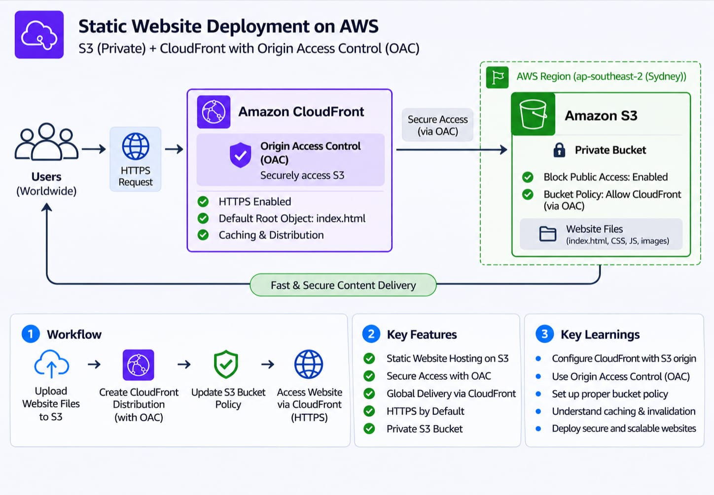
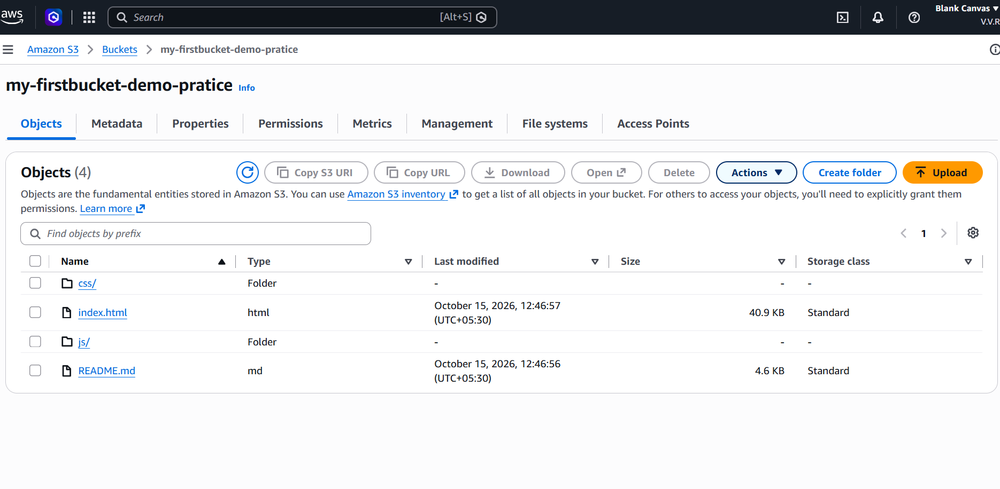
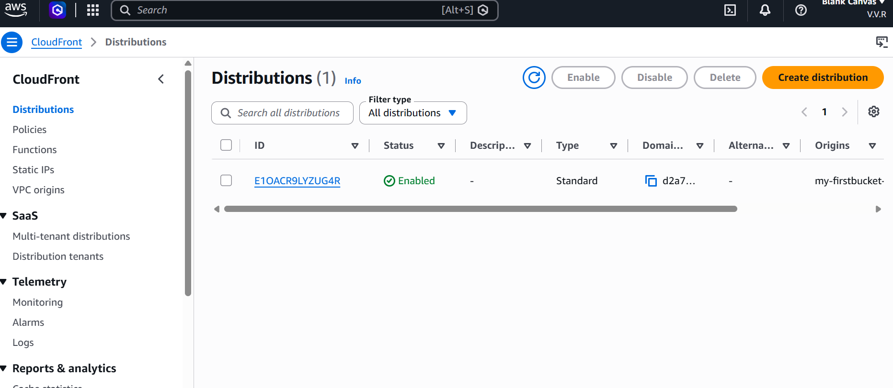

# AWS Static Website Hosting with Amazon S3 & CloudFront

## 📌 Project Overview

This project demonstrates how I deployed a static website on **Amazon Web Services (AWS)** using Amazon S3 for storing website files and Amazon CloudFront for fast, secure content delivery.

The objective was to gain practical experience with static website deployment, cloud storage, CDN configuration, and delivering website content to users around the world.

## 🏗️ Architecture

```text
          User / Browser
                |
                v
       Amazon CloudFront
       (Content Delivery)
                |
                v
        Origin Access Control
                |
                v
           Amazon S3
       (HTML, CSS, JS, Images)
```

### AWS Services Used

- **Amazon S3:** Stores static website files such as HTML, CSS, JavaScript, and images.
- **Amazon CloudFront:** Distributes website content through AWS edge locations to reduce latency.
- **Origin Access Control (OAC):** Allows CloudFront to securely access objects in a private S3 bucket.

## 🛠️ Technologies Used

- Amazon Web Services (AWS)
- Amazon S3
- Amazon CloudFront
- HTML5
- CSS3
- JavaScript
- Git and GitHub

## 🚀 Implementation Steps

### 1. Created the Static Website

I prepared the static website files, including:

```text
website/
├── index.html
├── style.css
├── script.js
└── images/
```

The website consists of frontend files that can be delivered directly to users without requiring a backend server.

### 2. Created an Amazon S3 Bucket

1. Opened the AWS Management Console.
2. Navigated to Amazon S3.
3. Created an S3 bucket with a globally unique name.
4. Selected the appropriate AWS Region.
5. Kept Block Public Access enabled for the bucket.

The S3 bucket serves as the origin storage for the website files.

### 3. Uploaded Website Files

Uploaded the website's HTML, CSS, JavaScript, and image files to the S3 bucket.

The main entry point of the website was `index.html`.

### 4. Configured Amazon CloudFront

1. Opened the Amazon CloudFront console.
2. Created a CloudFront distribution.
3. Selected the S3 bucket as the origin.
4. Configured Origin Access Control (OAC).
5. Set `index.html` as the default root object.
6. Enabled HTTPS redirection for viewer requests.
7. Updated the S3 bucket policy to allow access through the CloudFront distribution.

This configuration allows users to access the website through CloudFront without making the S3 bucket publicly accessible.

### 5. Deployed and Tested the Website

After the distribution was deployed, I accessed the website using its CloudFront distribution domain.

I verified that:

- The website loaded successfully.
- CSS, JavaScript, and image files were served correctly.
- The website was accessible over HTTPS.
- CloudFront could retrieve content from the private S3 origin.

### 6. Updated Website Content

Whenever website files were updated in S3, I checked the changes through the CloudFront distribution.

If cached content prevented the latest changes from appearing, I created a CloudFront invalidation for the relevant paths, such as `/*`.

## 🔐 Security Considerations

- Kept S3 Block Public Access enabled.
- Used Origin Access Control (OAC) to restrict access to the S3 origin.
- Allowed CloudFront access through a bucket policy scoped to the distribution.
- Used HTTPS to encrypt communication between visitors and CloudFront.

## 📚 Key Learnings

Through this project, I gained practical knowledge of:

- Storing and managing static website files in Amazon S3.
- Configuring an Amazon CloudFront distribution.
- Understanding how a Content Delivery Network (CDN) improves content delivery.
- Configuring Origin Access Control between CloudFront and S3.
- Using HTTPS for secure website access.
- Understanding caching and cache invalidation in CloudFront.
- Integrating AWS services to deploy a static website.

## 💡 Future Improvements

- Configure a custom domain using Amazon Route 53.
- Add an SSL/TLS certificate through AWS Certificate Manager.
- Automate deployments using GitHub Actions.
- Configure CloudFront access logs and monitoring.
- Implement Infrastructure as Code (IaC) using Terraform.

## 📸 Project Screenshots

<div align="center"> 
 
</div>

<br>

<div align="center">   
 
</div>

<br>

<div align="center">   

</div>

## 👨‍💻 Project Author

**Vineet Vikram Rao**

---

⭐ If you find this project useful, feel free to explore the repository and learn more about AWS cloud deployment.
